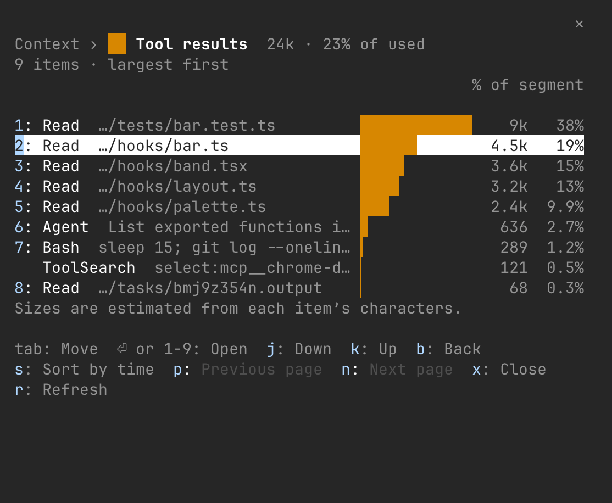
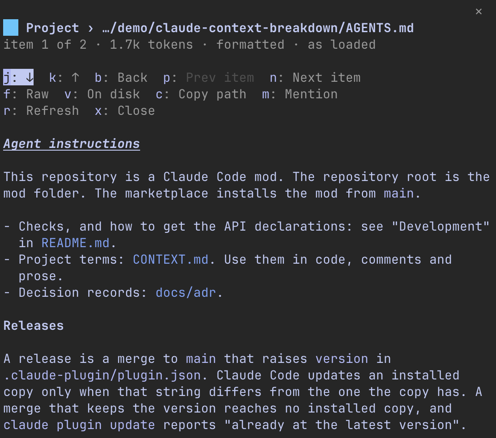

<p align="center">
  
</p>

<h1 align="center">claude-context-breakdown</h1>

<p align="center">
  <strong>See what fills your Claude Code context window.</strong><br>
  A bar above your prompt shows the whole window. Open any segment to read the text the model received.
</p>

To try it, type this in a Claude Code session. You need Claude Code 2.1.287 or newer. It runs in a terminal and in the Claude desktop app.

```
/plugin install context-breakdown --marketplace chapati23/claude-context-breakdown
```

The bar appears after the next model response. [All install steps](#install) cover the shell and the desktop app.


*The bar is the row above the prompt, at the bottom left. The pane on the right opens with `/ctx`.*

## From "how full?" to "full of what?"

Claude Code's `/context` lists what is in the window, but only when you ask. It has one row, Messages, for the whole conversation. When a session grows, that row does not say which tool, which file read or which skill grew it.

`context-breakdown` is a Claude Code mod that keeps the answer on screen. In the session above, 222k of the 1M tokens are in use. The bar shows at a glance that tool results fill most of it. `/ctx tool` opens them: eight file reads, 168k tokens in all, and the largest read alone takes 31k.

## What you get

### A bar that stays on screen

The bar is one row above the prompt. Its full length is the window. Each coloured stretch is one segment: the system prompt, your instruction files, tool results, your prompts, Claude's output, and the rest. Cool colours are the baseline, the content that is in the window before your first prompt. Warm colours are the conversation. The total and the largest conversation segment stand at the right: `222k/1M 22% · Tool results 168k`.


In Claude Code's [fullscreen rendering](https://code.claude.com/docs/en/fullscreen) (`/tui fullscreen` switches it on), point at a segment to see its name and size in a chip, as above, and click it to open its items. With the keyboard, press `ctrl+x`, then `tab`, and move along the bar with `tab`.

Neighbouring segments differ in lightness as well as hue. [A test](tests/palette.test.ts) checks that they stay apart for normal vision and for simulated deuteranopia and protanopia, the two common forms of colour blindness.

### The conversation, split into its parts

Tool results, skill bodies, task reports, system notifications, your prompts, Claude's output and the compaction summary each get a segment. The baseline has its own segments too: the system prompt and built-in tools, MCP tools, your global instructions, your project instructions, auto-memory, and the lists of skills and custom agents.

### Every segment opens down to the text

Type `/ctx` to open the pane. It lists every segment with its tokens and its share of what is used. When free space falls below 10% of the window, the heading of the pane warns.

Open a segment to list its items: each tool call, each instruction file, each prompt. These are the items of Tool results, largest first:



Open an item to read its text as loaded, which is the text the model received. That can differ from the file on disk now, because you can edit a file after Claude Code has read it. This is a project instruction file:



### What your last prompt added

After a prompt, the pane gets an `added` column: the tokens each segment gained since you sent that prompt, for example `+252` next to Claude output in the first picture. A segment that did not grow leaves its cell blank. In a terminal, the column needs a pane about 60 columns wide.

### Where your setup spends tokens

Baseline content costs tokens before you type anything. Open Global instructions or Project instructions to see each file and its size. The pane also has a block for content outside the window: tool schemas that Claude Code loads on demand. In the session above, that is `MCP tools · 10 servers, 227 tools`, 88k tokens once loaded. Open that row to list the servers, largest first. When Claude Code loads a tool, its schema moves into the window, into MCP tools and instructions.

## Safe to try

- **Local, and it writes no file.** The mod makes no API request, sends no content anywhere and never submits a prompt. It reads a file from disk only for the item you have open. Two keys act, and only when you press them: `c` copies the path of the open file, and `m` puts its `@path` into your prompt. The code that runs is in [`hooks/`](hooks).
- **Labelled estimates.** Every figure is an estimate, and the pane says so: `All numbers are estimates.`
- **One row, your theme.** The bar is one row above the prompt, and the pane takes space only while it is open. The colours come from your Claude Code theme.
- **Easy to remove.** `claude plugin uninstall context-breakdown@claude-context-breakdown` removes a user-scope install. Add `--scope project` or `--scope local` for the other scopes.

## Install

You need Claude Code 2.1.287 or newer. At the prompt of a terminal session:

```
/plugin install context-breakdown --marketplace chapati23/claude-context-breakdown
```

Answer `y` to add the marketplace, then choose a scope. The user scope makes the mod available in all your projects. The bar appears after the next model response.

From a shell:

```
claude plugin install context-breakdown --marketplace chapati23/claude-context-breakdown
```

In the Claude desktop app, `/plugin` does not run. Click **+** next to the prompt box, then **Plugins**, then **Add marketplace** with `chapati23/claude-context-breakdown`, then **Add plugin**. An install at the user scope from a terminal also loads in the local sessions of the desktop app. Start a new session to see the bar.

In the mobile app and in the editor, the bar is drawn as an image, and only the total is a button: a click on it opens the segments. [Surfaces](docs/reference.md#surfaces) describes what each one draws.

## Try it

1. Send any prompt. The bar appears after the response.
2. Type `/ctx`. The pane opens and takes the keyboard.
3. In a terminal, press the digit before a row to open it. On every surface, a click on a row opens it. Press `b` to go back and `x` to close. `Esc` gives the keyboard back to the prompt.
4. Type `/ctx tool` to open the items of Tool results. The start of any segment's name works.

The keys for every surface are in [Use](docs/reference.md#use).

## How it works

- A mod is a Claude Code plugin that draws inside the interface. This one uses Claude Code's mods API, which is in early access. [The decision record](docs/adr/0001-build-as-a-mod-on-the-early-access-api.md) says why a mod, and not a status line, a transcript parser or a proxy.
- The mod reads the breakdown that Claude Code builds for `/context`, and the messages of your session. It sorts them into segments and draws the bar and the pane.
- The conversation split is the mod's own estimate: it counts the characters of each kind of content and applies those shares to Claude Code's total for the conversation. The total and the baseline segments are Claude Code's own figures. [How the numbers are made](docs/reference.md#how-the-numbers-are-made) has the details.

## Good to know

- **Early version.** This is a 0.x release. Claude Code's mods API is early access and can change between releases, and a Claude Code update can break the mod.
- **Main session only.** The mod does not show the windows of subagents.
- **No history.** It shows how the window grew since your last prompt, and keeps nothing older.
- **The pictures show a terminal.** They are one session: mod 0.11.1, Claude Code 2.1.332, a 1M window. The desktop app, the editor and the mobile app draw the same pane with their own look and keys.

[Limits](docs/reference.md#limits) lists the rest.

## Update

By default, Claude Code does not update this mod by itself. From a shell:

```
claude plugin marketplace update claude-context-breakdown
claude plugin update context-breakdown@claude-context-breakdown
```

Then restart Claude Code. The first command reads the newest version from GitHub, and the second one installs it.

To get new versions without these commands, turn on auto-update for the marketplace: run `/plugin`, open **Marketplaces**, choose `claude-context-breakdown`, and choose **Enable auto-update**. Claude Code then updates the mod in the background and tells you when to reload.

## More

- [Reference](docs/reference.md): every segment, every key and every figure.
- [Development](docs/development.md): the checks, how to load the folder as a mod, and the icon. It links the project's terms, the product record and the decision records.

Found a bug, or have an idea? [Open an issue](https://github.com/chapati23/claude-context-breakdown/issues).

## Licence

MIT. See [LICENSE](LICENSE).
