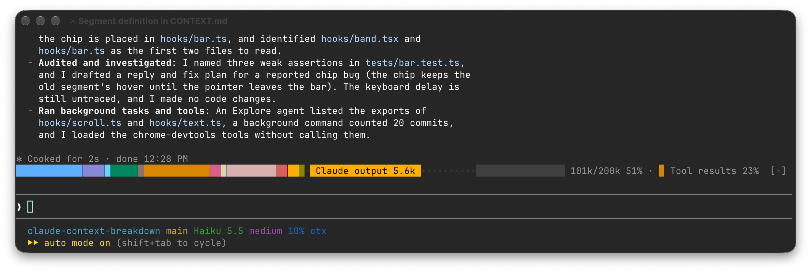

# claude-context-breakdown

See what fills your Claude Code context window.

`context-breakdown` is a Claude Code mod. It draws one bar above the prompt. The full length of the bar is the model's context window. Each coloured segment is one kind of content: the system prompt, your instruction files, tool results, your prompts, and so on. A pane lists every segment with its size.

Claude Code's own `/context` command shows a similar report, but only when you ask for it, and it shows the whole conversation as one number. This mod stays on screen, updates while you work, and splits the conversation into its parts.


The pictures in this file show Claude Code in Ghostty, in sessions with a 200k window: version 2.1.328, and version 2.1.327 for the picture of the bar. They were taken before version 0.11.0 of the mod: there the legend right of the total gives a percent of what is used (`Tool results 23%`). The legend now gives the segment's tokens (`Tool results 114k`).

> Status: early version. The mod uses Claude Code's mods API, which is early access and can change between releases.

## Segments

The bar shows two groups, from left to right.

**Baseline** is the content that is in the window before your first prompt:

| Segment | Content |
| --- | --- |
| System prompt and built-in tools | Claude Code's own instructions and tool schemas |
| MCP tools and instructions | Loaded MCP tool schemas and the instructions of MCP servers |
| Global instructions | Your user-level `CLAUDE.md` and managed instruction files |
| Project instructions | The `CLAUDE.md` files of the project |
| Auto-memory | The memory index that Claude Code loads |
| Skills list and custom agents | The one-line listings of skills and agents |

**Conversation** is the content that enters the window after the session starts:

| Segment | Content |
| --- | --- |
| Compaction summary | The summary that replaced the earlier conversation |
| Tool results | The output of tool calls, such as file reads and command output |
| Skill bodies | The full instructions of each skill that ran |
| Task reports | Notifications from background tasks and subagents |
| System notifications | Hook output, reminders, the output of local commands such as `/context`, and other text that Claude Code adds |
| Your prompts | What you typed or pasted, including the slash commands and shell lines you ran |
| Claude output | Replies, thinking, and tool-call inputs |

After the segments come the free space and, at the right end, the compaction reserve: the part of the window that Claude Code keeps free so that a compaction has room to run.

Tool schemas that Claude Code loads on demand are not in the window. The pane lists them in a separate block, "Not loaded · outside the window".

### From /context to segments

Claude Code's `/context` report lists categories. The mod sorts each category by its kind first, then by its name:

| `/context` category | Where the mod shows it |
| --- | --- |
| System prompt | System prompt and built-in tools |
| System tools | System prompt and built-in tools |
| MCP tools | MCP tools and instructions |
| MCP server instructions | MCP tools and instructions |
| Custom agents | Skills list and custom agents |
| Skills | Skills list and custom agents |
| Memory files | Split by file: Global instructions (user and managed files), Project instructions (project and local files), Auto-memory |
| Messages | Split into the conversation segments, by the mod's own estimate |
| Free space | Free space, computed again from the window, the used content and the reserve |
| Autocompact buffer | Reserve |
| MCP tools (deferred) | Not loaded, in the pane: one row that opens a list with one row per MCP server |
| System tools (deferred) | Not loaded, in the pane |

A category whose name starts with "Slash command" also goes to Skills list and custom agents. A category that the mod does not know goes to Other. A memory file of an unknown type goes to Other too. When no memory file has a token figure, the whole Memory files category goes to Other. When the messages cannot be read, Messages is one Conversation segment.

### Reading the bar



- A thin gap separates each segment from the next. The compaction summary has a texture (`▓`) in place of a plain colour, and no gap after it.
- Right of the bar is the total, then the largest conversation segment with its tokens: `364k/1M 36% · ▉ Tool results 114k`. The percent of the total is rounded to the nearest whole number, as Claude Code's status line rounds it. It shows 99% until the window is full, and `<1%` for a window that holds less than half a percent.
- Until you first open the pane in a session, the place of the largest segment reads `· /ctx for details`. After that, it names the largest segment.
- In the fullscreen layout, point at a segment to see its name and size in a chip beside it. With the keyboard, press `ctrl+x`, then `tab`, and move along the bar with `tab`; the chip follows. The bar shows one chip at a time.
- The keyboard chip goes away 4 seconds after the focus last moved, or at once when the focus moves into a pane, a prompt is sent, or you click a segment. Claude Code does not tell a mod when `Esc` or typing takes the keyboard back, so until then the chip can stay for up to 4 seconds. While it shows, pointing at another segment shows no chip.
- A chip stays inside the bar when it fits there, on the right of its segment or else on the left. A chip that does not fit covers the total and the legend to the end of the row.
- A chip covers the cells beside its segment, all but the nearest one. While the pointer is on a chip, that chip stays, because Claude Code counts a chip as part of its segment. Move the pointer along the bar cell by cell, or off the bar and back, to see another segment's chip.
- The segment under the focus or the pointer keeps its colour. Its last cell turns to a darker shade (a lighter one in a light theme), so you can see which segment it is. The compaction summary shows a thinner texture instead.
- A segment that is too small for a cell of its own shares a cell with its neighbours. The chip names every segment of the cell, or the first one and how many more when space is short.
- Baseline segments have cool colours and conversation segments have warm colours. Neighbours also differ in lightness, and the palette is tested for the two common forms of colour blindness. There is one palette for dark themes and one for light themes. The theme `auto` uses the dark palette, because a mod cannot read which one `auto` resolved to.

## Install

You need Claude Code 2.1.287 or newer. At the prompt of a terminal session:

```
/plugin install context-breakdown --marketplace chapati23/claude-context-breakdown
```

Answer `y` to add the marketplace, then choose a scope. The bar appears after the next model response.

From a shell:

```
claude plugin install context-breakdown --marketplace chapati23/claude-context-breakdown
```

In the Claude desktop app, `/plugin` does not run. Click **+** next to the prompt box, then **Plugins**, then **Add marketplace** with `chapati23/claude-context-breakdown`, then **Add plugin**.

An install at the user scope from a terminal also loads in the local sessions of the desktop app. Start a new session to see the bar. The desktop app draws the bar's cells, the `·` and the legend's swatch in its code font, with the same cells as the terminal, so the gaps between the total, the `·`, the swatch and the legend's words are one cell wide. It draws the total and the legend's words in its own face. If the app cannot run the bar's module, the mod draws the bar as a picture from then on, with the total as its only button, until the mod loads again. The bar, the pane and the minimized pane take their colours from the Claude Code theme setting, not from the app's light or dark appearance.

In the mobile app and in the editor, the bar is a picture, and the total and the legend are in the app's own face. Only the total is a button: a click on it opens the segments.

The desktop app, the editor and the mobile app draw the same pane. It differs from the terminal's pane in its look and its keys: see "Use".

## Update

By default, Claude Code does not update this mod by itself. From a shell:

```
claude plugin marketplace update claude-context-breakdown
claude plugin update context-breakdown@claude-context-breakdown
```

Then restart Claude Code. The first command reads the newest version from GitHub, and the second one installs it.

To get new versions without these commands, turn on auto-update for the marketplace: run `/plugin`, open **Marketplaces**, choose `claude-context-breakdown`, and choose **Enable auto-update**. Claude Code then updates the mod in the background and tells you when to reload.

## Use

The bar is always visible above the prompt. When other mods also draw rows there, the bar takes the last row, right above the prompt. When the rows do not all fit in the space above the prompt, the bar keeps its place, so that it stays in view. When the bar is the only row and the space has room for two rows, a blank row separates the bar from the line above it. The pane has three levels:

1. **Segments.** Every segment with its tokens, its share of what is used, and the tokens it gained since your last prompt.
2. **Items.** The concrete things inside one segment: each instruction file, each tool result, each skill body, each prompt. The `MCP tools` row of Not loaded opens a list of the same kind: the MCP servers whose tools are not loaded.
3. **Content.** The text of one item as loaded, which is the text the model received.

| Items of one segment | Content of one item |
| --- | --- |
|  |  |

Open the pane:

- `/ctx` opens the segments. When the pane is already open, `/ctx` only gives it the keyboard: it keeps the level, the item, the page and the place it shows. The focus ring is then on the first control or row, which can be above the rows in view; `tab` moves the ring and brings it into view.
- `/ctx <segment>` opens the items of one segment. It accepts the start of the segment's name, for example `/ctx tool` or `/ctx global`. A word that is a whole name wins over a word that only starts a name. When two names start the same way, the segment that comes first in the bar wins. A word that matches no segment opens the segments with a note, for example `No segment matches "foo".` The note goes away when you open a segment.
- `/ctx not` opens the list of MCP servers whose tools are not loaded. `/ctx not-loaded` and `/ctx not loaded` open it too, and so does a start of "not loaded" that is longer than "not", such as `/ctx not l`. The list comes after the segments, so a word that opened a segment before still opens it: `/ctx n`, `/ctx no` and `/ctx noti` open System notifications. When no server has tools that are not loaded any more, `/ctx not` opens the segments with the note `All MCP tools are loaded now.` When the mod cannot read the breakdown, the note is `The breakdown could not be read.`
- In the fullscreen layout, a click on a bar segment opens the items of that segment.
- In the desktop app, a click on a bar segment opens the items of that segment. A click on the total, on the legend, or anywhere right of the bar opens the segments. A cell that holds several small segments opens the segments. While the pointer is on a segment, the other segments are drawn dim, and the segment's name and tokens take the place of the legend. The pointer on the total or the legend dims no segment.

Keys in the pane:

The terminal and the other surfaces use different keys to move in the pane. In the terminal, the pane adds keys of its own: `j`, `k`, and the arrow keys that step the ring along the rows. In the desktop app, and on every other surface that is not the terminal, the pane uses the app's own keys only. There, `tab` and `shift+tab` move the focus, `enter` opens a row, and the mouse wheel and the arrow keys scroll an item's text. The reason: the desktop app does not tell the mod where `tab` moved the focus, so a step of the mod's own could start from the wrong row.

| Key | Where | Action |
| --- | --- | --- |
| `tab`, `shift+tab` | Segments, items | Move the focus ring along the rows and the controls |
| `enter` | Segments, items | Open the row with the ring |
| `1` to `9`, `0` | Segments, items | Terminal only. Open that row: `1` to `9` for the first nine rows that open, `0` for the tenth |
| `↓`, `↑` | Segments, items | In the terminal, move the focus ring to the next or the previous row. On other surfaces, the app's own keys: they scroll a list that is taller than the pane, and do nothing in a list that fits |
| `j`, `k` | Segments, items | Terminal only. Move the focus ring to the next or the previous row. In the items, `j` on the last row of a page opens the next page with the ring on its first row, and `k` on the first row opens the previous page with the ring on its last row. Where the ring has no row to go to, `j` and `k` scroll the pane by one line |
| `↓`, `↑` | Content | Scroll the text |
| `j`, `k` | Content | Terminal only. Scroll down or up by one line. In a large item, `j` at the bottom of a page continues on the next page and `k` at the top goes back to the bottom of the previous page |
| `b` | Items, content | Go back one level |
| `s` | Items of a conversation segment, the list of servers | Switch between largest first and newest first; in the list of servers, between largest first and most tools first |
| `n`, `p` | Items of a list with pages, content | Next page, previous page. A list has pages when it holds more than 20 rows. An item has pages only when it is longer than about 500 lines or 40,000 characters. The formatted view can start a new page slightly earlier. In the content, on an item's last page `n` opens the next item of its list, and on its first page `p` opens the previous one: the label then says `Next item` or `Prev item`. The step follows the list's order, across its pages, and passes over the rows that do not open. The item opens at its first page, as loaded, in its own view. `j`, `k`, the mouse wheel and the `Next page` button below the text never go to another item |
| `v` | Content of an item that has a file | Switch between the text as loaded and the file on disk |
| `f` | Content | Switch between the formatted text and the raw text. In the terminal the other view opens at the line that the pane showed first. On other surfaces it opens at the top of the page that holds the first line of the page shown |
| `c` | Content of an item that has a file | Copy the file's path |
| `m` | Content of an item that has a file | Put `@path` into the prompt |
| `r` | All levels | Measure again |
| `x` | All levels | Close the pane |

The controls line names each key with a short label, in fixed groups. The first group moves: the words for Enter and the digits (`⏎ 1-9: Open`, or `⏎ 1-9 0: Open` when the page has a tenth row that opens, or `⏎: Open` in a pane narrower than 32 columns; off the terminal always `⏎: Open`, because the rows there have no digit), then `j: ↓`, `k: ↑`, `b: Back`, `p: Prev page` and `n: Next page` (`p: Prev item` and `n: Next item` where they step to another item). At the content level a second group changes the view: `f`, `v`, `c` and `m`. The last group is for the whole pane: `s` in a list, then `r: Refresh` and `x: Close`. `x: Close` is always the last control. The line breaks only between groups; a group wider than the pane wraps inside itself. The arrows and `tab` keep working, but the line does not name them.

In the terminal, the controls line stands below the segments and the items, and above the content. Where Claude Code gives the pane fewer rows than the segments or the items take, the controls line stands above them, so the keys show when the pane opens. An example is the short pane above the prompt in a terminal narrower than 110 columns. Claude Code scrolls the pane to keep the row with the ring in view, so the controls line scrolls out while that row is below the first rows. When the ring comes back to the first row, the pane scrolls to its top and the controls line shows again.

The keys work while the pane has the keyboard. `/ctx` gives it the keyboard; after a click on the bar, click the pane's text or run `/ctx`. A click on a row or a control of the pane presses it, but leaves the keyboard where it was. (`ctrl+x` then `tab` moves the keyboard to the bar, not to the pane.) While the pane does not have the keyboard, a line above the controls says so; off the terminal, in the items, the line comes last. In the terminal, the controls are then plain buttons to click. In the desktop app and in the editor, the keys stay drawn on the controls, but they work only while the pane has the keyboard. The rows there have no keys. The mobile app has no keyboard: as in the terminal, it draws the keys only while the pane has the keyboard. `Esc` returns the keyboard to the prompt and leaves the pane open.

Each level shows the keys that can apply on the screen as it is, always in the same order. A key that cannot apply there leaves the line: `b` on the segments, which have no level to go back to; `s` in a list that has one order only (a baseline segment, or the list of servers when Claude Code gives no token figure for them); `p` and `n` together in a list that has one page, and at the content level for an item of one page that is the only one of its list that opens; `v` for an item that cannot switch between as loaded and on disk; `c` and `m` for an item that has no file. A key that can apply again after a move on the same screen stays in the line, fainter, and does nothing until then: `p` on the first page of several, `n` on the last page, `n: Next item` on the last item of the list. The keys that remain keep their order. In the terminal, while the pane has the keyboard, the pane still takes the letter of a key that left the line, and the press does nothing, so a reflex press does not reach the prompt. On every other surface the letter of a key that left the line goes to the prompt. A letter that is in no line at all goes to the prompt on every surface.

After `b`, the focus ring is on the row you opened. After `n` or `p` stepped to another item, `b` opens the page of the list that holds that item, with the ring on its row. A list that you open has the ring on its first row. On surfaces other than the terminal, a key that keeps the level, such as `n`, `p`, `s` or `v`, leaves the focus on its control, also when `n` or `p` opens another item.

In the terminal, the controls line has `j: ↓` and `k: ↑` while the pane has the keyboard. In the segments and the items, `j`, `k` and the arrow keys move the ring by one row, and the row with the ring stays in view. When the ring is on no row, for example on a control, `j` and `↓` go to the first row, and `k` and `↑` to the last. After a click on `↓` or `↑`, the ring is on that control, and `j` and `k` go on from the row the ring was on before. On the first and last rows of the segments, and on the first row of the first page and the last row of the last page of the items, the ring stays where it is, and `j`, `k` and the arrow keys scroll the pane by one line, so the lines above and below the rows come into view. A list with no row that opens, such as the skills list or the list of servers, has no ring to move: there `j`, `k` and the arrow keys always scroll the pane. A held key moves the ring row by row and stops on the row of the last press. The mouse wheel still scrolls the pane.

In the content of an item, the mouse wheel and the arrow keys scroll the text. In the terminal, `j` and `k` scroll it too.

In the desktop app, the pane draws no `↓` or `↑` control and no `j` or `k`, at any level. In the segments and the items, the words before the controls say `⏎: Open`: `enter` opens the row with the focus. The app limits a mod's scroll to the height the pane had when it opened, so the mod moves the window only to its top: `f`, `v`, `n` and `p` show the new text from its top. When Claude adds an item to the list that the pane shows, the focus stays on its row: a new first row does not take it.

In the desktop app, the app draws the key of each control as a small key cap inside its button, before the label. The controls keep their key caps with and without the keyboard. The rows have no key cap, so every row starts its name in the same column. The controls line keeps the same controls in the same order, so `Esc` adds only the line that says how to get the keys.

Reading the pane:

- The heading gives the tokens in use and the tokens that are free before a compaction: `283k used · 684k free before compaction`.
- When free space is below 10% of the window, the heading warns. Its free part, for example `33k free before compaction`, takes Claude Code's warning colour and stays bold. The line below it names the largest segment and its share of what is used, where it has room: `1M window · largest: Tool results 61%`. A narrow pane that has room for one figure only shows the free figure, `33k free`, in place of the used figure. Above 10% the heading and the line below it do not change.
- The group headings say what each group holds, where the table has room: `Baseline · before your first prompt` and `Conversation · since the session started`. The reserve's row says `Reserve for compaction` where its name column has room.
- In the terminal, a dim line below the table says what the row with the focus ring holds, for example `Tool results: the output of tool calls, such as file reads and command output.` It always takes two rows, so no line below it moves when the ring moves. The rows stay blank while the ring is on a control or the pane does not have the keyboard. A text longer than two rows ends in `…`. Other surfaces do not tell the mod where the focus is, so they draw no such line.
- In the items, the line under the title gives the segment's definition. The facts (`9 items · largest first`) and the column name (`% of segment`) share one row where they fit on it. A row that does not open has a dim name when other rows on the page open; its bar keeps the segment's colour. Where no row opens, as in the list of servers or a skills list without its listing in the conversation, the names are at full strength.
- In the terminal, text below a table, such as `All numbers are estimates.`, is no wider than the table. One blank row stands between a table and the notes below it.
- Each row has a length bar. In the segments level, the largest segment fills the bar column. In the items level, the largest item on the page fills it.
- In the terminal, the largest segment's name is bold. The row with the focus ring, and the row under the pointer, is drawn as one highlight band: the name and the figures stand on it at full strength, and the bar keeps its colour and its length. Claude Code draws the highlight, and the hotkey digit on it, in its own colours.
- In the desktop app, the row's name is a native button with no key cap, and the app draws the focus on it in its own style. No name is bold. The tokens are at full strength, and the share is dim.
- In the desktop app, the editor and the mobile app, the segments and the items stand in a grid at most 64 cells wide. A cell is a little wider than a column of the pane, so the grid reaches 64 cells in a pane about 67 columns wide; in a wider pane it does not stretch. The content uses the pane's whole width. Each figure ends in the same column on every row. In the segments, a picture of the bar stands under the heading, and the line below it gives the window and the column names. Each segment row starts with a swatch in the segment's colour. Free space and the reserve have a swatch in their texture and no length bar. A segment's row shows its full name where it fits, else its short name, else the short name cut. In the items, a title that is too long for its column is cut to fit. A long title that is not a path is cut in its middle, so both ends show: two tools of one server keep different labels. A path that does not fit, in a title or in the detail after it, is cut at its head: it keeps the end of its file name and stays inside its column. In the items of a segment, the title has a swatch, and the segment's figures stand at its right. The controls stand under the segment's definition, above the facts and the rows. The line that says how to get the keys comes last there. In the content, the title has a swatch.
- The percentage of a segment is its share of what is used, not of the window. The percentage of an item is its share of its segment. Percentages are rounded to the nearest, so the rows of a group add up to the group within rounding.
- After your prompt, the segments get the column `added`: the tokens each segment gained since you submitted that prompt, for example `+14k`. A segment that did not grow leaves the cell blank. A group heading shows the sum of its rows' figures. A dim line below the table says `added: tokens since your last prompt.` While a baseline segment gained tokens, the line adds `A baseline segment grows when Claude Code loads more of its content later.`: the Baseline heading says `before your first prompt`, and Claude Code can still load content of the baseline after it, for example the tools of an MCP server that connects late. Only a prompt that you submit starts the count again: at the prompt, through Remote Control, or as the own turn of a host that uses the SDK (`claude -p`, the Agent SDK). The desktop app and VS Code are probably such hosts. A slash command such as `/ctx`, a task notification, a scheduled task, a prompt from another session or from a mod, and a prompt that a hook stops do not. `/clear` ends the count until your next prompt. A compaction ends it until your second prompt after it: until the next response the figures are an estimate, and the count starts from a measurement only. In a conversation longer than 4,096 messages the mod drops the oldest messages from its count, so a segment can gain content and still show no figure.
- The column shows only while a segment grew, while no figure is an estimate (`~`), while no fewer tokens are in use than at your prompt (after a rewind, for example), and while the table has room for 7 more cells. The column never narrows the names. In the terminal the length bars give up cells for it, down to 4, so it shows in a pane about 60 columns wide or wider, such as the side pane of a terminal 150 columns wide. In the desktop app, the editor and the mobile app the bars keep their cells, so the column shows only where every segment's name stays as it is without the column. The figures follow each measurement, so new content shows in the column once Claude Code has measured it. The conversation segments share the measured tokens by characters, so a segment's tokens can move when another segment grows. A conversation segment therefore shows a figure only when its own characters grew since your prompt.
- The segments end with the "Not loaded · outside the window" block: the tool schemas that Claude Code loads on demand, such as `MCP tools` and `System tools`, with their tokens. These tokens are not part of the total.
- While an MCP server has tools that are not loaded, the `MCP tools` row counts them, for example `MCP tools · 30 servers, 696 tools`, and opens a list of the servers. Where the row has less room it drops the tools, then the counts. The row comes after the segment rows when the ring moves. In the terminal, it has a digit only when it is among the first ten rows that open. With no such server it is a plain line. `System tools` is always a plain line.
- The list of servers has one row per server: its name, the number of its tools that are not loaded yet, a length bar, the tokens their schemas take once loaded, and the share of the whole. The whole is the figure that Claude Code gives for the `MCP tools` category, the one the `MCP tools` row shows at the segments, and the title and the column name repeat it (`414k once loaded`, `% of 414k`). The list reads that figure when it reads its rows, so until the next measurement it can be newer than the figure at the segments. Only when Claude Code gives no figure for the category is the whole the sum of the servers. The bar is grey: the content is outside the window, so it has no segment's colour. The largest server comes first; `s` switches to most tools first and back. In the terminal the mod cuts a long server name, so the table keeps its width; the desktop app and the editor cut it at its end, and the mobile app cuts it in its middle. The rows do not open. When Claude Code gives no token figure for these tools, the list orders the servers by their tools, draws no bar and no share, and leaves the token column empty; `s` then leaves the line. `b` goes back to the segments with the ring on the `MCP tools` row. When a measurement finds no server left, the pane goes back to the segments. When you open the list, or press `s`, `p` or `n` in it, and no server is left, the segments show with the note `All MCP tools are loaded now.` A tool that is loaded is in the window: it is an item of MCP tools and instructions.

The content level shows the title, the facts line and the controls above the text, so the heading stays in view when an item or a page opens. The title has the form of the items' title: `Context › ██ Global instructions › ~/.claude/CLAUDE.md`. Where that does not fit on one line, it takes the segment's short name, then drops `Context › `, as the items' title does. The facts line starts with the item's place in its list, for example `item 2 of 9 · 4.5k tokens · raw · as loaded`. The count holds every item of the list, also the rows that do not open. A page that has a next page ends with a `Next page` button.

The content level has two views. The formatted view draws Markdown as Claude's replies are drawn: bold headings, lists, tables, and code blocks. The raw view shows the text as written, with line numbers. It leaves out terminal escape sequences and shows other control characters as `?`. Markdown files, skill bodies, prompts, Claude output, and the compaction summary open formatted. A Markdown file opens formatted also when it is the result of a `Read` call: the formatted view leaves out the line numbers that the tool adds, and the raw view shows them. Other tool results, task reports and system notifications open raw.

Claude Code cuts a line of code after about 2,000 characters. So the raw view splits a line that is longer than 1,000 characters into pieces, and the facts line says `long lines split`. Where the view numbers the lines, each piece repeats its line's number, and the lines after it keep their numbers.

When a file changed on disk after Claude Code loaded it, the content view says so.

When a compaction or `/clear` removes the item or every item of the list that the pane shows, the pane goes back to the segments and says so. After `/clear`, a list or item of a baseline segment goes back to the segments with no note, because baseline content stays in the context.

## How the numbers are made

- Every number is an estimate. The mod reads Claude Code's summary breakdown and makes no request to the API. The summary estimates each baseline category locally. `/context` can count with the API, so a baseline category can differ from `/context` by a few hundred tokens. The total is the same, because both match the conversation to the last response's usage, and the conversation then differs by the same amount.
- The sizes of the conversation segments are the mod's own estimate. It counts the characters of each kind of content and applies those shares to the engine's total for the conversation.
- The size of a conversation item is its share of characters in its segment. The sizes of baseline items are the engine's own figures.
- Claude Code sends the skills list, the MCP server instructions, the agent types and the memory files as reminders in the first message, and again after a compaction. In live sessions its breakdown counted them in the baseline, so the mod leaves them out of the conversation. The API description does not state this. Of the agent types, only the entries of custom agents are baseline; the built-in types stay under System notifications. Text after the skills list in the same reminder also stays under System notifications. Other reminders, such as the environment, the sandbox rules, the list of tools that load on demand and the date, are counted under System notifications, because no breakdown category names them. It is not known how Claude Code's own breakdown counts them.
- Claude Code can put the report of a background task inside a reminder that says the text is not your input. The mod counts that whole reminder under Task reports. A reminder that shares its text block with other content stays under System notifications.
- The output of a local command counts under System notifications, also where it has no tag: in the form the mod reads, the report of `/context` comes as plain text right after the command line.
- In the items of Skills list and custom agents, a skill or agent opens its entry as loaded. The MCP server instructions open as loaded too. A row opens only when the conversation still holds its reminder.
- Directly after a compaction, Claude Code has no new measurement until the next model response. Until then the mod estimates the conversation from its text and marks the total with `~`.

## Limits

- The reserve marks the compaction that runs when the window is almost full. Claude Code can also compact a session while it is idle, shortly before the prompt cache expires, at any fill level. The bar cannot show that one in advance. The setting `"idleCompaction": false` in `settings.json` turns it off.
- The mod shows the main session only. It does not show the windows of subagents.
- The system prompt has no finer split, because Claude Code does not report one.
- The mod shows how the window grew since your last prompt only (the column `added`). It keeps no history.
- The 10% threshold for the heading's warning is the mod's own, not a Claude Code setting. Only the pane's heading warns: the bar and the minimized pane do not. After a compaction the used figure is an estimate, so the warning can come and go between two measurements.
- The mod reads at most the newest 4,096 messages of a conversation. The pane says so when older items are not listed.
- The mod reads a file from disk only for the item that you have open: when you open it or step to it with `n` or `p`, when `r` measures again, and when you change the page or the view of the file on disk. It never writes files and never sends content anywhere.
- In the terminal, the pane takes the letter of a key that left the line through a control that it does not draw. The mods API offers no other way to take a key without drawing it. `tab` would stop on such a control with no ring to show, so the pane moves the ring past it at once: `tab` from `Close` goes on to the `Next page` button below an item's text where there is one, else to the first row or control of the pane, and `shift+tab` comes back to `Close`. A cost: `tab` from `Close` then passes over the pane's own close mark (`✕`), which `shift+tab` still reaches.

## Development

The repository root is the mod folder. Three checks must pass:

```
claude plugin validate .
claude plugin test .
tsc -p .
```

`tsc` needs TypeScript 5.4 or newer and the API declarations in `.claude-plugin/types/`. Claude Code writes them when it loads the folder as a mod, for example with `claude --plugin-dir .`. Git ignores that folder, so a new clone or worktree does not have it. Load the folder once as a mod, or copy `.claude-plugin/types/` from a checkout that has it. `claude plugin validate .` and `claude plugin test .` do not need the folder; only `tsc -p .` does. Without the folder, `tsc` stops with TS5083 and writes no file. If `tsc` is not on your PATH, run `npx --yes -p typescript@5.9.3 tsc -p .`, or use any other TypeScript 5.4 or newer.

The icon `.claude-plugin/icon.png` is a 1024 px export of `docs/img/icon.svg`. `icon` in `plugin.json` names the file for the plugin directory; Claude Code does not read that field. One unit of the drawing is one pixel at 34 px. The lists of the directory at claude.ai/directory drew their icons at that size on 2026-11-20. To change the icon, change the drawing and export it again; a browser at a 1024 by 1024 window can do that. The plugin directory accepts a square PNG of 512 to 2048 px on each side, under 2 MB, and reads it only once: the first time the plugin is saved or submitted in the developer portal. A later change of the file does not change the icon of that listing. `claude plugin validate` states this rule when the file is missing. So settle the icon before the first save, and check it in the portal.

A pull request that changes a file under `hooks/`, `types/` or `.claude-plugin/` must raise the version in `.claude-plugin/plugin.json`. Without a new version, an installed copy does not update. The rule is in "Releases" in [AGENTS.md](AGENTS.md). `scripts/check-version.sh origin/main` checks it, and CI runs that script on every pull request. A pull request merges only when this check passed.

The desktop app has no `--plugin-dir` flag. To load the folder in its local sessions, add two entries to the `env` block of `~/.claude/settings.json`, then start a new session:

```json
"env": {
  "CLAUDE_CODE_PLUGIN_DIRS": "/absolute/path/to/claude-context-breakdown",
  "CLAUDE_CODE_PLUGIN_DIR_WATCH": "1"
}
```

`CLAUDE_CODE_PLUGIN_DIR_WATCH` makes the session reload the mod when a file changes.

Project terms are defined in [CONTEXT.md](CONTEXT.md). Decision records are in [docs/adr](docs/adr).

## Licence

MIT. See [LICENSE](LICENSE).
